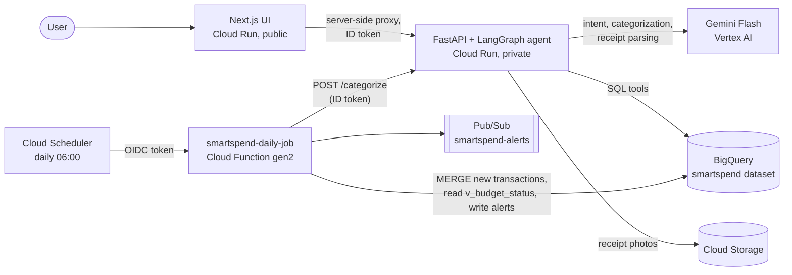

# SmartSpend AI

A personal budgeting and financial-advisor app built serverless and cloud-native on **Google Cloud**.

- **Vertex AI (Gemini)** is the reasoning engine: it parses receipt photos, cleans and categorizes messy bank descriptors like `SQ *BLUE BOTTLE CO 0423`, and classifies what the user is asking.
- **Cloud Run** hosts the FastAPI backend, the LangGraph advisor agent, and the Next.js UI.
- **BigQuery** is the financial data warehouse for transactions, receipts, budgets, and alerts, and it runs the analytics SQL.
- **Cloud Scheduler + Cloud Functions** run the daily transaction ingest and send proactive budget alerts.

The demo runs on **synthetic** data: a deterministic generator produces 12 months of realistic, messy transactions and receipt photos. You can also add your own: multiple cards and accounts, transactions typed in by hand, and **credit card statements** (CSV read with rules, PDF read by Gemini) that you review row by row before they're imported.

> **Demo video:** _add link_ · **Live demo:** available on request (password-protected to protect the cloud budget)

<!-- Add a screenshot: save it as docs/screenshot.png -->
<!--  -->

## Architecture



The browser reaches only the public UI. The UI calls the **private** API with a Google-signed ID token minted for its own service account. Cloud Scheduler calls the daily function with OIDC. More detail, including the BigQuery model, cost guardrails and security, is in [docs/architecture.md](docs/architecture.md).

## Design decisions

| Decision | Why |
|---|---|
| Gemini returns **structured output** validated by Pydantic and enums | Typed answers, no free-text parsing; invented IDs and invalid categories are rejected |
| The agent **never writes SQL**: LangGraph classifies intent → fixed, parameterized BigQuery tools → grounded answer | Safe against prompt injection, testable, and every answer is traceable to the data used |
| Categorization is **batched** (40 per call) and measured against ground-truth labels | Low cost; accuracy is a regression check you can rerun after any prompt or model change |
| Receipts get an **independent arithmetic check** and are matched to a card transaction | The model's extraction is verified, not trusted |
| Writes use **load jobs + `MERGE`** on `transaction_id` | Free, idempotent re-runs; no streaming-buffer limits on DML |
| Statements are **previewed before import**, deduped by deterministic row IDs, and every import can be undone | Rules first for CSVs (free, exact), Gemini only for PDFs and unknown layouts; nothing an LLM read is saved without a human seeing it |
| Alerts are **pace-based** and fire once per category per month | Useful early in the month, never noisy |
| API and agent in **one private Cloud Run service** that scales 0 to 2 | Zero idle cost and a hard ceiling on spend |
| **Five least-privilege service accounts** and dataset-level BigQuery access | Each identity can do exactly one job |

## Results

- Gemini categorized all 73 of the recent, uncategorized synthetic transactions correctly (mean confidence 0.97). The synthetic descriptors are cleaner than real bank data, so treat this as a regression baseline.
- 39 Python tests (agent, API, daily job and data generator) run with in-memory fakes and need no GCP access.
- Idle cost is $0: every runtime scales to zero, with a $50/month billing alert.

## Repository layout

| Folder | What it contains |
|---|---|
| `infra/terraform/` | APIs, BigQuery dataset, tables and views, GCS bucket, Artifact Registry, Pub/Sub, service accounts, billing budget |
| `data/` | Synthetic generator, receipt renderer, and BigQuery loader, with tests |
| `agent/` | LangGraph advisor agent: Gemini intent routing, BigQuery tools, categorizer, receipt parser |
| `api/` | FastAPI service on Cloud Run (also hosts the agent) |
| `ui/` | Next.js dashboard on Cloud Run, calling the private API through a server-side proxy |
| `functions/` | Daily Cloud Function run by Cloud Scheduler: ingest, categorize, budget alerts |
| `scripts/` | `bootstrap.ps1` (one-time setup), `deploy_api.ps1`, `deploy_jobs.ps1`, `deploy_ui.ps1` |

## Prerequisites (Windows)

```powershell
winget install Google.CloudSDK
winget install Hashicorp.Terraform
winget install astral-sh.uv
```

Open a new terminal after installing so PATH updates.

## One-time GCP setup

1. **Create the project and link the trial billing account:**

   ```powershell
   gcloud auth login
   gcloud auth application-default login
   gcloud billing accounts list                      # copy the ACCOUNT_ID
   $P = "smartspend-ai-$(Get-Random -Maximum 999999)"
   gcloud projects create $P --name "SmartSpend AI"
   gcloud billing projects link $P --billing-account XXXXXX-XXXXXX-XXXXXX
   ```

2. **Provision the infrastructure, generate data, and load BigQuery:**

   ```powershell
   ./scripts/bootstrap.ps1 -ProjectId $P -BillingAccount XXXXXX-XXXXXX-XXXXXX
   ```

   This enables the APIs, creates everything in `infra/terraform`, generates the synthetic data, loads it into `smartspend.*`, and uploads 24 sample receipts to `gs://$P-smartspend-receipts/samples/`.

3. **Try a query in the BigQuery console:**

   ```sql
   SELECT * FROM smartspend.v_budget_status ORDER BY pct_used DESC;
   ```

## Deploy the API and agent

```powershell
./scripts/bootstrap.ps1 -ProjectId $P -BillingAccount XXXXXX-XXXXXX-XXXXXX -SkipData  # apply infra changes only
uv sync --all-packages
uv run python -m smartspend_agent --project $P   # check that Gemini on Vertex AI answers
./scripts/deploy_api.ps1 -ProjectId $P
```

`deploy_api.ps1` builds with Cloud Build, deploys a private Cloud Run service, categorizes the pending transactions, prints Gemini's accuracy against ground truth, and asks the advisor a question. See [api/README.md](api/README.md) for the endpoints and how to run the API locally.

Run all Python tests with `uv run pytest`. They use fakes and need no GCP access.

## Deploy the daily job and the UI

```powershell
./scripts/deploy_jobs.ps1 -ProjectId $P                          # Cloud Function + Cloud Scheduler (06:00 daily), runs once now
./scripts/deploy_ui.ps1 -ProjectId $P -DemoPassword "pick-one"   # public Next.js site on Cloud Run
```

## Working with the data locally

```powershell
cd data
uv sync
uv run pytest                     # generator and schema tests
uv run python generate.py --help  # months, seed, number of receipts, uncategorized window
```

The most recent 30 days are loaded **uncategorized** on purpose. Those are the rows the Gemini categorizer fills in during step 2. `category_labels` keeps the true answers so we can report categorization accuracy.

## Tear down

```powershell
terraform -chdir=infra/terraform destroy -var "project_id=$P"
gcloud projects delete $P
```
