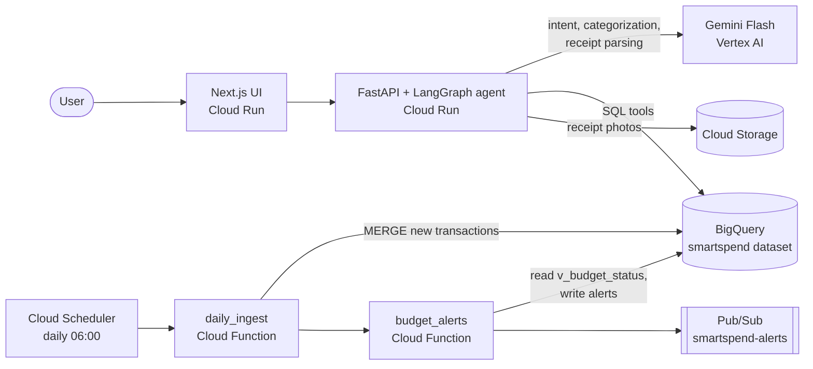

# Architecture

## BigQuery model

| Object | Kind | Purpose |
|---|---|---|
| `transactions` | table, monthly partitions on `txn_date`, clustered by `user_id, category` | Bank feed. `category`, `merchant_name`, `category_source`, `category_confidence` are filled by Gemini |
| `receipts` | table, nested `line_items` | Gemini multimodal parse of uploaded receipts, matched to a transaction |
| `budgets` | table | Monthly limit per category, versioned by `effective_from` |
| `alerts` | table, daily partitions | Proactive alerts from the scheduled job |
| `category_labels` | table | Synthetic ground truth, used to measure categorizer accuracy |
| `v_monthly_category_spend` | view | Spend by month and category (excludes transfers and income) |
| `v_budget_status` | view | Month-to-date spend against the current budget |

## Cost guardrails ($200 trial credit)

- Cloud Run and Cloud Functions scale to zero, so idle cost is $0.
- Gemini **Flash** models only; categorization is batched (many transactions per call).
- BigQuery stays inside the free tier (10 GB storage, 1 TB queries/month) at this data size.
- Billing budget alert at 50/90/100% of $50/month (Terraform `budget.tf`).
- Receipts bucket deletes objects after 90 days; Artifact Registry keeps the 5 newest images.

## Security

- One service account per runtime with least privilege (see `infra/terraform/iam.tf`).
- Dataset-level, not project-level, BigQuery write access.
- Receipts bucket has public access prevention enforced.
- Synthetic data only: no real financial data ever enters the project.
